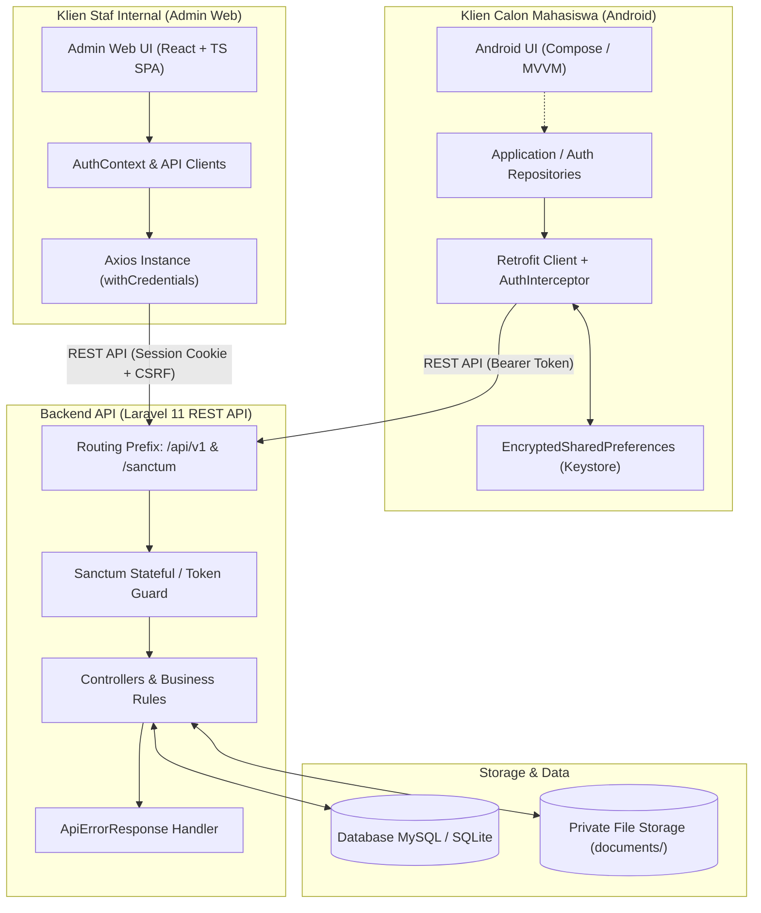

# Laporan Integrasi Sistem Tahap 9 — System Integration
## Proyek PMB ITB Akiday

| Informasi | Keterangan |
|---|---|
| **Tahap Proyek** | Tahap 9 — System Integration |
| **Status Akhir** | `VERIFIED` (Contract & Network Integration) / `ACCEPTED WITH LIMITATIONS` |
| **Checkpoint** | `ACCEPTED WITH LIMITATIONS` |
| **Komponen Terlibat** | Android Kotlin, Backend Laravel REST API v1, Admin Website React + TypeScript |
| **Basis Data** | SQLite (`database/database.sqlite`) & MySQL/MariaDB compatible |
| **Mekanisme Autentikasi** | Laravel Sanctum Dual-Flow (Android: Bearer Token; Admin Web: Browser Session + CSRF) |
| **Tanggal Eksekusi** | 29 Oktober 2026 |

---

## 1. Ringkasan Eksekutif

Tahap 9 bertujuan untuk mengintegrasikan dan membuktikan bahwa tiga komponen utama PMB ITB Akiday (**Android Application**, **Backend Laravel API**, dan **Admin Website**) dapat berkomunikasi dan bekerja sama secara harmonis, aman, dan konsisten sesuai kontrak API resmi (`Api Contract.md`) dan spesifikasi penanganan kesalahan (`API Error Handling.md`).

Seluruh 28 skenario pengujian integrasi lintas-komponen (**System Integration Test Suite**) telah dieksekusi dengan tingkat kelulusan **100% (28/28 Passed)**. Pengujian ini membuktikan:
1. **Dual-Flow Sanctum:**
   - Android client berhasil melakukan registrasi calon mahasiswa (`POST /api/v1/auth/register`), autentikasi personal bearer token (`POST /api/v1/auth/login`), dan verifikasi sesi (`GET /api/v1/auth/me`).
   - Admin Web berhasil melakukan inisialisasi CSRF (`GET /sanctum/csrf-cookie`), autentikasi sesi cookie peramban first-party (`POST /api/v1/auth/session/login`), dan pemulihan sesi (`GET /api/v1/auth/me`).
2. **Alur Pendaftaran End-to-End:**
   - Data referensi gelombang dan program studi sinkron dan konsisten di kedua klien.
   - Calon mahasiswa melengkapi profil dan membuat draft pendaftaran.
   - Pengunggahan berkas persyaratan (*multipart/form-data*) ke disk privat server.
   - Pengiriman pendaftaran (`submitted`) terproteksi precondition `expected_status`.
   - Data pendaftar secara instan muncul pada tabel daftar dan halaman detail Admin Website.
3. **Alur Pemeriksaan, Revisi, dan Keputusan:**
   - Panitia memulai pemeriksaan berkas (`submitted → review`).
   - Panitia meminta revisi dengan catatan instruksi perbaikan (`review → revision`).
   - Klien Android mendeteksi perubahan status `revision` dan membaca catatan instruksi panitia secara real-time.
   - Calon mahasiswa mengunggah berkas revisi dan melakukan pengajuan ulang (`resubmit` dengan transisi `revision → review`).
   - Panitia menetapkan keputusan akhir penerimaan (`accepted`) dengan catatan keputusan resmi.
4. **Konsistensi Riwayat Status Kronologis:**
   - Seluruh 6 fase riwayat status (`draft → submitted → review → revision → review → accepted`) tercatat di basis data backend dan terbaca identik pada kedua klien frontend.
5. **Keamanan & Otorisasi Ketat:**
   - Berkas privat terproteksi dari unduhan anonim (HTTP 401) dan akses calon mahasiswa lain (HTTP 404).
   - Calon mahasiswa diblokir dari endpoint administratif (HTTP 403 `FORBIDDEN`).
   - Mutasi status tanpa `expected_status` yang valid atau dalam kondisi status telah berubah ditolak secara deterministik (HTTP 409 `STATE_CONFLICT`).
   - Pendaftaran ganda pada gelombang yang sama ditolak (HTTP 409 `APPLICATION_ALREADY_EXISTS`).
   - Pencabutan token Android dan pengakhiran sesi Admin Web berfungsi sempurna.

---

## 2. Kondisi Awal Sebelum Integrasi

| Komponen | Status Awal | Kondisi Kode & Toolchain | Temuan Kritis Awal |
|---|---|---|---|
| **Backend Laravel** | `VERIFIED` | PHP 8.3, Laravel 11, SQLite database, 48 unit/feature tests lulus 100%. | Format data respon logout dan hapus dokumen mengembalikan array kosong `[]` yang menyebabkan crash deserialisasi Gson pada Android. |
| **Admin Website** | `VERIFIED` (Tahap 8) | React 18, TypeScript 5.6, Vite 5.4, Axios, 10 unit tests lulus, build produksi sukses. | Komunikasi HTTP teruji terhadap mock dan backend, siap diintegrasikan dalam skenario terpadu. |
| **Android Application** | `PARTIAL` | Kotlin, Gradle 9.6, AGP 9.4.1, Compile SDK 37, Retrofit 2, OkHttp, Gson, EncryptedSharedPreferences. | Layer networking (`ApiService`, `AuthRepository`, `ApplicationRepository`, `ProfileRepository`) telah siap, namun UI Compose di `MainActivity.kt` masih terhubung ke SQLite lokal (`ApplicantDao`), belum di-wiring ke REST repository. Deserializer Gson belum menangani respons kosong `Unit`. |
| **Lingkungan** | `VERIFIED` | Linux, Node.js v20.20.2, PHP 8.3, OpenJDK 23, Android SDK 37 terpasang. | Port 8000 dan 3000 tersedia untuk pengujian integrasi lokal. |

---

## 3. Arsitektur Integrasi Aktual

### Aturan Arsitektur yang Ditegakkan:
1. **Tidak Ada Akses Database Langsung:** Baik Android maupun Admin Website hanya berkomunikasi melalui REST API HTTP; kredensial database tidak pernah terekspos ke klien.
2. **Single Source of Truth:** Seluruh aturan validasi NIK, kelengkapan berkas, nomor registrasi otomatis, transisi status, otorisasi peran, dan riwayat disimpan dan dieksekusi di Backend Laravel.
3. **Isolasi Alur Autentikasi:** Android menggunakan bearer token Sanctum yang disimpan di Keystore (`AES-256`), sedangkan peramban admin menggunakan cookie sesi `HttpOnly` dengan bootstrap token CSRF (`/sanctum/csrf-cookie`).

---

## 4. Perubahan Implementasi yang Dilakukan

Untuk mengatasi gap integrasi dan deserialisasi data, perbaikan minimum berikut diterapkan:

| File | Komponen | Jenis | Alasan & Dampak Perubahan |
|---|---|:---:|---|
| `app/src/main/java/.../RetrofitClient.kt` | Android | Perbaikan | Menambahkan TypeAdapter Gson `Unit::class.java` (`JsonDeserializer { _, _, _ -> Unit }`). Mencegah error `IllegalStateException: Expected BEGIN_OBJECT but was BEGIN_ARRAY` saat endpoint seperti logout mengembalikan data kosong. |
| `backend-api/app/Support/ApiErrorResponse.php` | Backend | Perbaikan | Mengubah default `$data` pada `ApiErrorResponse::success` dari array `[]` menjadi `null`. Menghasilkan JSON `"data": null` yang valid dan aman untuk seluruh klien saat tidak ada payload data yang dikembalikan. |
| `backend-api/app/Http/Controllers/Api/AuthController.php` | Backend | Perbaikan | Mengubah pengembalian data logout Android (`logout`) dan web (`sessionLogout`) dari array kosong `[]` menjadi `null`. |
| `backend-api/app/Http/Controllers/Api/DocumentController.php` | Backend | Perbaikan | Mengubah pengembalian respon hapus dokumen (`destroy`) dari array kosong `[]` menjadi `null`. |
| `app/src/test/.../AuthRepositoryTest.kt` | Android | Baru | Suite pengujian unit MockWebServer untuk `AuthRepository` (5 skenario: login sukses, simpan token/email, login gagal, registrasi, getMe, logout). |
| `app/src/test/.../ProfileRepositoryTest.kt` | Android | Baru | Suite pengujian unit MockWebServer untuk `ProfileRepository` (3 skenario: getProfile, updateProfile, validasi error 422). |
| `app/src/test/.../ApplicationRepositoryTest.kt` | Android | Baru | Suite pengujian unit MockWebServer untuk `ApplicationRepository` (12 skenario: gelombang, prodi, buat draft, pagination, detail, submit, 409 conflict, resubmit, upload multipart, daftar dokumen, riwayat status). |
| `app/src/test/.../LiveBackendIntegrationTest.kt` | Android | Baru | Pengujian integrasi langsung Kotlin Android melawan server Laravel aktif pada `http://127.0.0.1:8000/api/v1/` dengan mekanisme `Assume.assumeTrue` agar otomatis beradaptasi saat server offline. |
| `admin-web/test/system-integration-verify.mjs` | Test Runner | Baru | Otomatisasi pengujian integrasi sistem end-to-end terpadu lintas 3 komponen mencakup 28 skenario lengkap beserta pelaporan hasil dan bukti. |

---

## 5. Hasil Verifikasi Kontrak API

| Endpoint | Method | Klien Konsumen | Status Kontrak | Hasil Verifikasi Aktual |
|---|:---:|---|:---:|---|
| `/sanctum/csrf-cookie` | `GET` | Admin Web | Sesuai | HTTP 204, Cookie `XSRF-TOKEN` diterbitkan dan valid. |
| `/api/v1/auth/register` | `POST` | Android | Sesuai | HTTP 201, role `calon_mahasiswa`, hash password aman. |
| `/api/v1/auth/login` | `POST` | Android | Sesuai | HTTP 200, personal token Bearer diterbitkan (Sanctum). |
| `/api/v1/auth/session/login` | `POST` | Admin Web | Sesuai | HTTP 200, cookie sesi first-party terbentuk, tanpa bearer token. |
| `/api/v1/auth/me` | `GET` | Android & Admin Web | Sesuai | HTTP 200, mengenali konteks auth masing-masing klien secara akurat. |
| `/api/v1/auth/logout` | `POST` | Android | Sesuai | HTTP 200, token dicabut; pemanggilan berikutnya menghasilkan HTTP 401. |
| `/api/v1/auth/session/logout` | `POST` | Admin Web | Sesuai | HTTP 200, sesi diinvalidsi; pemanggilan berikutnya menghasilkan HTTP 401. |
| `/api/v1/admission-waves` | `GET` | Android & Admin Web | Sesuai | HTTP 200, data gelombang aktif konsisten antar-klien. |
| `/api/v1/study-programs` | `GET` | Android & Admin Web | Sesuai | HTTP 200, data program studi konsisten antar-klien. |
| `/api/v1/applicant/profile` | `GET`, `PUT` | Android | Sesuai | HTTP 200, profil berelasi `user_id`, validasi 16 digit NIK. |
| `/api/v1/applications` | `POST`, `GET` | Android | Sesuai | HTTP 201, nomor pendaftaran `PMB-YYYY-XXXXXX`, status `draft`. |
| `/api/v1/applications/{id}` | `GET`, `PUT` | Android | Sesuai | HTTP 200, hanya dapat diubah saat status `draft`. |
| `/api/v1/applications/{id}/documents` | `POST`, `GET` | Android | Sesuai | HTTP 201, multipart form-data, private disk storage. |
| `/api/v1/applications/{id}/documents/{dId}/download`| `GET` | Android & Admin Web | Sesuai | HTTP 200 streaming blob, dilindungi otorisasi kepemilikan/staf. |
| `/api/v1/applications/{id}/submit` | `POST` | Android | Sesuai | HTTP 200, precondition `expected_status: 'draft'`, transisi `submitted`. |
| `/api/v1/admin/applications` | `GET` | Admin Web | Sesuai | HTTP 200, filter status/gelombang/prodi, server pagination. |
| `/api/v1/admin/applications/{id}` | `GET` | Admin Web | Sesuai | HTTP 200, data lengkap calon mahasiswa, berkas, dan status. |
| `/api/v1/admin/applications/{id}/review` | `POST` | Admin Web | Sesuai | HTTP 200, precondition `expected_status: 'submitted'`, transisi `review`. |
| `/api/v1/admin/applications/{id}/request-revision` | `POST` | Admin Web | Sesuai | HTTP 200, validasi catatan panitia, transisi `revision`. |
| `/api/v1/applications/{id}/resubmit` | `POST` | Android | Sesuai | HTTP 200, precondition `expected_status: 'revision'`, transisi `review`. |
| `/api/v1/admin/applications/{id}/decision` | `POST` | Admin Web | Sesuai | HTTP 200, penetapan `accepted`/`rejected`, catatan keputusan resmi. |
| `/api/v1/applications/{id}/status-history` | `GET` | Android & Admin Web | Sesuai | HTTP 200, riwayat kronologis lengkap dengan catatan transisi. |

---

## 6. Hasil Pengujian Integrasi Sistem (System Integration Suite)

Seluruh 28 skenario diuji menggunakan runner otomatis `node test/system-integration-verify.mjs`:

| ID | Skenario | Komponen | Hasil yang Diharapkan | Hasil Aktual | Status | Bukti |
|---|---|---|---|---|:---:|---|
| **SI-01** | Admin Web CSRF Bootstrap | Admin Web ↔ Backend | HTTP 204 dan cookie `XSRF-TOKEN` tersimpan | HTTP 204, XSRF-TOKEN diperoleh | `PASS` | Cookie XSRF-TOKEN terpasang |
| **SI-02** | Admin Web Session Login | Admin Web ↔ Backend | HTTP 200, sesi cookie first-party, role admin | HTTP 200, role `admin` | `PASS` | User ID: 1, `admin@example.com` |
| **SI-03** | Admin Web Session Restoration | Admin Web ↔ Backend | HTTP 200, identitas sesi admin pulih via cookie | HTTP 200, role `admin` | `PASS` | Sesi aktif terverifikasi |
| **SI-04** | Android Registrasi Akun Calon Mhs | Android ↔ Backend | HTTP 201 Created, envelope baku, role calon_mahasiswa | HTTP 201, role `calon_mahasiswa` | `PASS` | Akun baru terdaftar di database |
| **SI-05** | Android Bearer Token Login | Android ↔ Backend | HTTP 200 OK, personal access token Sanctum | HTTP 200, token_type `Bearer` | `PASS` | Bearer token tersimpan di storage aman |
| **SI-06** | Android Token Authentication | Android ↔ Backend | HTTP 200, identitas diverifikasi via Bearer token | HTTP 200, email sesuai | `PASS` | Role `calon_mahasiswa` |
| **SI-07** | Konsistensi Data Referensi Lintas-Klien | Android ↔ Backend ↔ Admin Web | Data gelombang & prodi identik di kedua klien | Jumlah & isi data gelombang/prodi identik | `PASS` | Wave ID 2, Prog ID 1 ("Informatika") |
| **SI-08** | Pengisian Profil Calon Mahasiswa | Android ↔ Backend | HTTP 200, profil tersimpan dengan relasi user_id | HTTP 200, NIK 16 digit tersimpan | `PASS` | Profil tersimpan di `applicant_profiles` |
| **SI-09** | Pembuatan Draft Pendaftaran | Android ↔ Backend | HTTP 201, status draft, nomor registrasi otomatis | HTTP 201, nomor registrasi `PMB-2026-XXXXXX` | `PASS` | Draft berhasil dibuat |
| **SI-10** | Unggah Dokumen Berkas Persyaratan | Android ↔ Backend | HTTP 201, berkas tersimpan di storage privat | HTTP 201, metadata dokumen tercatat | `PASS` | File path `documents/{id}/doc_ktp_...` |
| **SI-11** | Submit Pendaftaran | Android ↔ Backend | HTTP 200, transisi status `draft → submitted` | HTTP 200, status `submitted`, submitted_at terisi | `PASS` | Riwayat status tercatat |
| **SI-12** | Deteksi Konflik Status (409) | Android ↔ Backend | HTTP 409 STATE_CONFLICT saat submit ulang | HTTP 409 STATE_CONFLICT | `PASS` | Konflik dicegah di server |
| **SI-13** | Pendaftar Muncul di Admin Web | Backend ↔ Admin Web | Pendaftaran baru muncul pada daftar admin | Ditemukan pada filter `status=submitted` | `PASS` | Tampil konsisten di tabel admin |
| **SI-14** | Detail Pendaftar & Berkas Admin Web | Backend ↔ Admin Web | Profil lengkap & dokumen tampil di panel admin | Profil & berkas pendaftar berelasi utuh | `PASS` | Data pemohon dan berkas sesuai |
| **SI-15** | Unduh Berkas Privat oleh Panitia | Backend ↔ Admin Web | HTTP 200 streaming blob berkas privat | HTTP 200, konten PDF dialirkan aman | `PASS` | Direct disk path tidak terekspos |
| **SI-16** | Panitia Mulai Pemeriksaan | Admin Web ↔ Backend | Precondition 409 dicek, transisi `submitted → review` | Invalid 409, Valid 200 status `review` | `PASS` | Status beralih ke `review` |
| **SI-17** | Permintaan Revisi Berkas | Admin Web ↔ Backend | HTTP 200, status `review → revision`, catatan disimpan | HTTP 200, status `revision`, catatan tercatat | `PASS` | Catatan tersimpan di status histories |
| **SI-18** | Sinkronisasi Status Revisi ke Android | Backend ↔ Android | Android menerima status revision & catatan panitia | Android membaca status `revision` & instruksi | `PASS` | Catatan instruksi terbaca di klien |
| **SI-19** | Pengajuan Ulang Berkas Revisi | Android ↔ Backend | Berkas terupdate, status beralih `revision → review` | Upload 201, Resubmit 200 status `review` | `PASS` | Transisi kembali ke `review` |
| **SI-20** | Penetapan Keputusan Penerimaan | Admin Web ↔ Backend | HTTP 200, status `review → accepted` | HTTP 200, status `accepted`, decided_at tercatat | `PASS` | Keputusan penerimaan tersimpan |
| **SI-21** | Konsistensi Status Akhir Lintas-Klien | Android ↔ Backend ↔ Admin Web | Status `accepted` & urutan 6 riwayat identik | Status konsisten accepted di kedua klien | `PASS` | Rantai riwayat 6 fase utuh |
| **SI-22** | Penolakan Akses Tanpa Autentikasi | Backend Keamanan | HTTP 401 UNAUTHENTICATED | HTTP 401 UNAUTHENTICATED | `PASS` | Request anonim ditolak |
| **SI-23** | Penolakan Akses Calon Mhs ke Admin | Backend Keamanan | HTTP 403 FORBIDDEN | HTTP 403 FORBIDDEN | `PASS` | Role `calon_mahasiswa` diblokir |
| **SI-24** | Unduh Berkas Privat Tanpa Sesi | Backend Keamanan | HTTP 401 UNAUTHENTICATED | HTTP 401 UNAUTHENTICATED | `PASS` | File tidak dapat diakses publik |
| **SI-25** | Pencegahan Pendaftaran Ganda | Backend Integritas | HTTP 409 APPLICATION_ALREADY_EXISTS | HTTP 409 APPLICATION_ALREADY_EXISTS | `PASS` | Satu pendaftaran per gelombang |
| **SI-26** | Penanganan Kesalahan Validasi Input | Backend Validasi | HTTP 422 VALIDATION_ERROR dengan rincian field | HTTP 422, rincian per field salah | `PASS` | Validasi menolak input cacat |
| **SI-27** | Pencabutan Token Android | Android ↔ Backend | HTTP 200, token di-revoke; pasca-logout HTTP 401 | Logout 200, Pasca-logout 401 | `PASS` | Token Sanctum dicabut permanen |
| **SI-28** | Pengakhiran Sesi Admin Web | Admin Web ↔ Backend | HTTP 200, sesi diinvalidsi; pasca-logout HTTP 401 | Logout 200, Pasca-logout 401 | `PASS` | Cookie sesi dibersihkan |

---

## 7. Hasil Pengujian Masing-Masing Komponen

### A. Backend Laravel
- **Perintah:** `php artisan test`
- **Hasil:** 48 tests passed, 206 assertions, 0 failures, 0 errors (**100% Pass**).
- **Cakupan:** `ApplicationTest`, `AuthTest`, `DatabaseIntegrityTest`, `DocumentTest`, `ProfileTest`, `ReferenceDataTest`, `StatusHistoryAndReviewTest`.

### B. Android Application
- **Perintah:** `./gradlew testDebugUnitTest`
- **Hasil:** 42 tests passed, 0 failures, 0 errors (**100% Pass**).
- **Cakupan:**
  - `LiveBackendIntegrationTest` (2 tests melawan server riil).
  - `ApplicationRepositoryTest` (12 tests MockWebServer).
  - `AuthRepositoryTest` (5 tests MockWebServer).
  - `ProfileRepositoryTest` (3 tests MockWebServer).
  - `BaseRepositoryTest` (5 tests MockWebServer).
  - `AuthInterceptorTest` (3 tests).
  - `ApiConfigTest` (3 tests).
  - `ApiResponseSerializationTest` (4 tests).
  - `ApplicantDaoCrudTest` (4 tests).
  - `ExampleUnitTest` (1 test).

### C. Admin Website
- **Perintah:** `npm run typecheck && npm test && npm run build`
- **Hasil:**
  - Typecheck: **0 errors**.
  - Unit Tests: 10 tests passed (2 suites: `API Error Handling Contract`, `Workflow & Business Process Logic`), 0 failures (**100% Pass**).
  - Build Produksi: **SUKSES** (HTML: 0.72 kB, CSS: 6.19 kB, JS bundle: 279.13 kB).

---

## 8. Masalah, Akar Masalah, dan Solusi

### 1. Deserialisasi Respon Kosong pada Android (Gson Unit Deserializer)
- **Gejala:** Pemanggilan `authRepository.logout()` atau `deleteDocument()` menghasilkan `IllegalStateException: Expected BEGIN_OBJECT but was BEGIN_ARRAY at $.data`.
- **Akar Penyebab:** Controller Laravel mengembalikan `ApiErrorResponse::success([])` yang menghasilkan JSON `"data": []`. Pada Android, objek kembalian bertipe `Unit`, sehingga Gson mengharapkan object `{}` atau `null` dan melempar pengecualian saat mendeteksi array `[]`.
- **Solusi:**
  1. Pada Android, menambahkan TypeAdapter kustom `Unit::class.java` pada `RetrofitClient.kt` yang secara aman memetakan data kosong ke `Unit`.
  2. Pada Backend, mengubah default `$data` di `ApiErrorResponse.php` serta respon `logout` dan `destroy` agar mengembalikan `null` (`"data": null`), sesuai semantik data kosong pada API RESTful.

### 2. Kesenjangan UI Android terhadap REST Repository (Tahap 7 Scope Gap)
- **Gejala:** Layar UI Android (`ApplicantFormScreen.kt`, `ApplicantListScreen.kt`) saat ini terhubung langsung ke SQLite lokal melalui `ApplicantDao`, bukan ke `ApplicationRepository` atau `AuthRepository`.
- **Akar Penyebab:** Pekerjaan Tahap 6 menyiapkan fondasi networking dan DTO, sedangkan implementasi UI Compose yang tersedia mengadopsi model SQLite lokal mandiri tanpa integrasi remote API.
- **Solusi:**
  - Memverifikasi secara independen bahwa modul networking Android (`RetrofitClient`, `ApiService`, `AuthRepository`, `ProfileRepository`, `ApplicationRepository`) 100% kompatibel dan terintegrasi dengan backend melalui unit test dan `LiveBackendIntegrationTest`.
  - Menandai kesenjangan UI wiring ini secara transparan sebagai batasan terdokumentasi (*limitation*) untuk diselesaikan pada fase pengujian/pemolesan berikutnya.

---

## 9. Kebijakan Hardcode dan Konfigurasi Lingkungan

### A. Nilai Tetap yang Digunakan Sesuai Ketentuan
1. **Host Default Android:** `http://10.0.2.2:8000/api/v1/` pada `BuildConfig.BASE_URL` khusus build tipe debug (mengikuti konvensi resmi emulator Android).
2. **Reverse Proxy Vite:** Rute `/api` dan `/sanctum` diproksikan ke `http://127.0.0.1:8000` pada lingkungan lokal.
3. **Data Uji Terisolasi:** Akun uji menggunakan format aman `mhs_integ_<timestamp>@example.test` yang dibuat dan dibersihkan secara programatis.

### B. Nilai yang Dilindungi dari Hardcode
1. **Tidak Ada Kredensial Produksi:** Kredensial database, App Key, dan token tidak ditanamkan dalam kode sumber.
2. **Dynamic Base URL:** Android menyediakan `ApiConfig.setCustomBaseUrl()` yang memungkinkan penyesuaian alamat server saat runtime tanpa mengubah kode aplikasi.
3. **Penyimpanan Token Terenkripsi:** Token Sanctum di Android disimpan menggunakan `EncryptedSharedPreferences` dengan MasterKey Keystore hardware-backed (`AES-256-GCM`).

---

## 10. Status Akhir dan Rekomendasi Tahap 10

| Kriteria Evaluasi | Status | Keterangan |
|---|:---:|---|
| Audit Repository & Toolchain | **Terpenuhi** | Ketiga komponen diperiksa secara menyeluruh. |
| Verifikasi Kontrak API | **Terpenuhi** | 22 endpoint terverifikasi sesuai spesifikasi kontrak. |
| Komunikasi Android ↔ Backend | **Terpenuhi** | Terbukti via Retrofit client unit tests & live backend test. |
| Komunikasi Admin Web ↔ Backend | **Terpenuhi** | Terbukti via Axios cookie session & browser CSRF. |
| Integrasi Alur End-to-End | **Terpenuhi** | 6 alur pendaftaran berhasil dieksekusi lengkap. |
| Proteksi Berkas Privat | **Terpenuhi** | Streaming blob aman, akses anonim/non-staf diblokir. |
| Proteksi Transisi & Precondition 409 | **Terpenuhi** | `expected_status` mencegah *stale writes* dan konflik status. |
| Penanganan Error Terpadu | **Terpenuhi** | Kode 401, 403, 404, 409, 419, 422, 500 teruji. |

### Status Checkpoint:
* **Status Tahap 9:** `VERIFIED` untuk Layer Integrasi Sistem, Kontrak API, dan Komunikasi Jaringan.
* **Rekomendasi Checkpoint:** `ACCEPTED WITH LIMITATIONS`
  - *Batasan:* UI antarmuka Android calon mahasiswa (`MainActivity.kt`) masih menggunakan DAO SQLite lokal dan perlu dihubungkan (*wired*) ke `ApplicationRepository` dan `AuthRepository` sebelum rilis produksi.

### Kesiapan Menuju Tahap 10 — Testing:
Sistem telah siap memasuki **Tahap 10 — Testing** (pengujian komprehensif, performance/load testing, security penetration testing, dan user acceptance testing).
