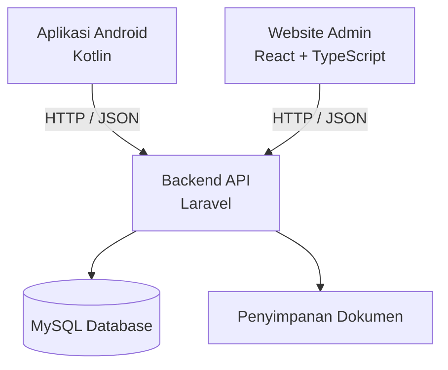

# Perencanaan Build — PMB ITB Akiday
## Mulai dari Tahap 2 sampai Selesai

Dokumen ini memuat rencana build secara menyeluruh untuk proyek **PMB ITB Akiday**, dengan asumsi fondasi proyek sudah dipahami. Fokus perencanaan adalah pelaksanaan teknis mulai dari penyiapan lingkungan dan repository, pengembangan sistem, integrasi, hingga penyelesaian.

---

## 1. Struktur Sistem yang Akan Dibangun

Build ini dilakukan untuk sistem dengan empat komponen utama yang saling terhubung:

1. **Aplikasi Android (Kotlin)**  
   Folder project: Android Studio  
   Fungsi: antarmuka calon mahasiswa untuk pendaftaran, dokumen, dan pemantauan status.

2. **Website Admin (React + TypeScript)**  
   Folder project: project web admin  
   Fungsi: pengelolaan dan pemeriksaan pendaftaran oleh admin dan panitia sesuai hak akses.

3. **Backend API (Laravel)**  
   Folder project: backend Laravel  
   Fungsi: API, autentikasi, logika bisnis, kontrol akses, dan penghubung ke database serta penyimpanan dokumen.

4. **MySQL Database + Penyimpanan Dokumen**  
   Database utama: MySQL  
   Penyimpanan dokumen: lokasi privat yang dikelola backend.

Alur hubungan komponen:

- Aplikasi Android dan Website Admin **tidak mengakses MySQL secara langsung**.
- Seluruh komunikasi data dilakukan melalui **Backend API Laravel**.
- Backend menerima permintaan, memvalidasi, memeriksa hak akses, kemudian membaca/menulis ke MySQL dan penyimpanan dokumen.

Diagram alur build sistem tidak dimaksudkan untuk menggambarkan alur pengguna, melainkan hubungan komponen yang akan dibangun:

---

## 2. Prinsip Build yang Digunakan

1. **Tiap komponen dibangun mengikuti ketergantungannya**
   - Backend API dan database harus cukup matang sebelum integrasi aplikasi.
   - Antarmuka tidak dibangun tanpa acuan API dan struktur data.

2. **Satu responsibility per komponen**
   - Android: tampilan dan interaksi calon mahasiswa.
   - Website Admin: pengelolaan dan pemeriksaan untuk peran admin/panitia.
   - Backend: aturan bisnis, validasi, dan pengelolaan data.
   - MySQL: penyimpanan terstruktur.
   - Penyimpanan dokumen: penampung file privat.

3. **Build dilakukan dengan시물si/Mock lebih dulu jika diperlukan**
   - Jika API atau data belum siap sepenuhnya, antarmuka dapat disiapkan dengan data simulasi sementara.

4. **Integrasi dilakukan bertahap**
   - Aplikasi dan admin website tidak langsung dijalankan bersama-sama tanpa uji komunikasi.

5. **Environment lokal harus konsisten**
   - Struktur folder, konfigurasi API, dan konektivitas lokal harus distandarisasi agar semua komponen bisa saling dijangkau saat pengembangan.

---

## 3. Rangkuman Tahapan Build

Build dilaksanakan secara bertahap:

| No | Tahap | Fokus | Komponen Utama |
|---|---|---|---|
| 2 | Repository & Environment | Struktur proyek dan lingkungan lokal | Semua komponen |
| 3 | Database Design | Tabel, relasi, dan aturan utama | MySQL + migration Laravel |
| 4 | API Design | Kontrak komunikasi | Backend API |
| 5 | Backend Laravel | API, autentikasi, logika bisnis | Backend API + MySQL |
| 6 | Android Project Setup | Proyek Kotlin dan struktur awal | Aplikasi Android |
| 7 | Android Fitur Inti | Fitur calon mahasiswa utama | Aplikasi Android |
| 8 | Website Admin Development | Antarmuka admin dan panitia | Website Admin |
| 9 | Integrasi Sistem | Koneksi antar komponen | Android + Web + Backend + MySQL |
| 10 | Pengujian | Fungsional, integrasi, dan akses | Seluruh sistem |
| 11 | Deployment Lokal & Backup | Siap jalankan di lokal dan dasar backup | Backend + MySQL + Dokumen |
| 12 | Rilis & Dokumentasi Final | Penyempurnaan dan dokumentasi terakhir | Seluruh sistem |

---

## 4. Detail Perencanaan Tiap Tahap

### Tahap 2: Repository & Environment

**Tujuan**  
Menyiapkan rak kerja proyek agar Android, Website Admin, Backend, dan Database dapat dikembangkan dalam satu ekosistem kerja yang rapi.

**Kegiatan utama**  
- Menyiapkan repository atau struktur folder untuk:
  - Aplikasi Android,
  - Website Admin,
  - Backend Laravel.
- Menyiapkan struktur folder masing-masing project agar mudah dipisahkan dan dipelihara.
- Menyiapkan environment lokal untuk:
  - PHP/Laravel,
  - MySQL,
  - Android development,
  - Web development/react.
- Menyiapkan konfigurasi dasar agar aplikasi dan admin website dapat mengarah ke backend yang sama di lokal.

**Keluaran**  
- Struktur folder proyek yang konsisten.
- Catatan environment kerja.
- Dasar konfigurasi untuk development lokal.

**Pengecekan singkat**  
- Apakah folder masing-masing komponen sudah tersedia?
- Apakah local environment mendukung Laravel, React/TypeScript, dan Android?
- Apakah semua komponen bisa dijalankan minimal di lingkup local development?

---

### Tahap 3: Database Design

**Tujuan**  
Menetapkan struktur data sebelum backend dan antarmuka dibangun lebih lanjut.

**Kegiatan utama**  
- Menentukan tabel utama, misalnya:
  - `roles`
  - `users`
  - `applicant_profiles`
  - `admission_waves`
  - `study_programs`
  - `applications`
  - `application_documents`
  - `application_status_histories`
- Menetapkan relasi antartabel.
- Menetapkan primary key, foreign key, dan constraint penting.
- Menetapkan nilai status pendaftaran dan aturan utamanya.
- Menyiapkan rancangan migration Laravel sesuai struktur tersebut.

**Keluaran**  
- Rancangan tabel dan relasi.
- Daftar constraint utama.
- Rencana urutan migration.
- Catatan keputusan yang masih perlu dikonfirmasi.

**Pengecekan singkat**  
- Apakah tabel sudah mencerminkan alur pendaftaran?
- Apakah relasi sudah logis?
- Apakah aturan unik dan transaksi sudah dipertimbangkan?

---

### Tahap 4: API Design

**Tujuan**  
Menetapkan kontrak komunikasi agar aplikasi dan admin website dapat berinteraksi dengan backend secara konsisten.

**Kegiatan utama**  
- Menentukan endpoint utama yang dibutuhkan untuk:
  - autentikasi dan akun,
  - profil dan referensi,
  - pendaftaran,
  - dokumen,
  - riwayat status,
  - dan endpoint pemeriksaan/pengelolaan untuk admin/panitia.
- Menentukan pola request dan response.
- Menetapkan mekanisme autentikasi dan pembatasan hak akses.
- Menetapkan bagaimana perubahan status dicatat dan divalidasi.

**Keluaran**  
- Daftar endpoint rancangan.
- Pola komunikasi antar komponen.
- Catatan mengenai endpoint yang mengubah status pendaftaran.

**Pengecekan singkat**  
- Apakah endpoint mendukung alur CRUD utama?
- Apakah hak akses sudah dipertimbangkan?
- Apakah aplikasi dan admin website bisa menggunakan kontrak yang sama?

---

### Tahap 5: Backend Laravel

**Tujuan**  
Membangun lapisan backend yang menjadi pusat aturan bisnis dan pengelolaan data.

**Kegiatan utama**  
- Menyiapkan project Laravel.
- Membangun autentikasi dan kontrol akses dasar.
- Membuat migration dan struktur database sesuai rancangan.
- Membangun endpoint utama yang telah dirancang.
- Membangun validasi data dan aturan bisnis.
- Menyiapkan mekanisme penyimpanan dokumen dan metadata terkait.
- Menyiapkan pencatatan riwayat status.

**Keluaran**  
- Backend Laravel yang berkembang.
- Struktur database yang terbentuk melalui migration.
- Endpoint awal yang dapat dipakai untuk integrasi.

**Pengecekan singkat**  
- Apakah API dapat merespons sesuai rancangan?
- Apakah autentikasi dan pembatasan hak akses sudah tercermin?
- Apakah aturan bisnis utama mulai berjalan?

---

### Tahap 6: Android Project Setup

**Tujuan**  
Menyiapkan proyek Android Kotlin di Android Studio sebagai dasar pengembangan aplikasi calon mahasiswa.

**Kegiatan utama**  
- Membuat proyek Android baru di Android Studio.
- Menyiapkan konfigurasi dasar project.
- Menambahkan dependensi yang dibutuhkan.
- Menentukan struktur UI dan arsitektur awal aplikasi.
- Menyiapkan lapisan komunikasi HTTP ke backend.
- Menyiapkan konfigurasi endpoint API lokal.

**Keluaran**  
- Proyek Android yang siap dikembangkan.
- Struktur awal aplikasi.
- Dasar komunikasi dengan backend.

**Pengecekan singkat**  
- Apakah proyek bisa dibuka dan dibangun di Android Studio?
- Apakah struktur aplikasi mendukung pengembangan fitur?
- Apakah konfigurasi lokasi API sudah tersedia?

---

### Tahap 7: Android Fitur Inti

**Tujuan**  
Membangun fitur utama aplikasi Android untuk calon mahasiswa sesuai ruang lingkup proyek.

**Kegiatan utama**  
- Membangun halaman/screen dan alur untuk:
  - registrasi dan login,
  - profil,
  - pemilihan gelombang dan program studi,
  - formulir pendaftaran,
  - unggahan dokumen,
  - status pendaftaran,
  - riwayat status.
- Menyesuaikan tipe input di formulir agar mendukung berbagai jenis input.
- Menghubungkan antarmuka dengan endpoint backend.
- Menangani tampilan error, loading, dan feedback pengguna.

**Keluaran**  
- Fitur Android utama yang dapat dipakai.
- UI yang mendukung alur pendaftaran calon mahasiswa.
- Komunikasi antara aplikasi dan backend pada fitur utama.

**Pengecekan singkat**  
- Apakah alur login, profil, pendaftaran, dokumen, dan status sudah tersedia?
- Apakah aplikasi dapat berkomunikasi dengan backend?
- Apakah input-form sudah mendukung jenis input yang dibutuhkan?

---

### Tahap 8: Website Admin Development

**Tujuan**  
Membangun antarmuka untuk peran admin dan panitia sesuai kebutuhan sistem.

**Kegiatan utama**  
- Menyiapkan proyek website admin dengan React + TypeScript.
- Membangun layar/dashboard untuk:
  - pengelolaan gelombang dan program studi,
  - daftar pendaftaran,
  - pemeriksaan dokumen,
  - permintaan revisi,
  - penentuan keputusan sesuai kewenangan,
  - dan pengelolaan pengguna/akun jika menjadi tanggung jawab admin.
- Menghubungkan antarmuka dengan endpoint backend.
- Menyesuaikan tampilan dan akses untuk peran yang berbeda.

**Keluaran**  
- Website admin yang dapat digunakan.
- Antarmuka pemeriksaan dan pengelolaan pendaftaran.
- Kemampuan akses berbasis peran di sisi web.

**Pengecekan singkat**  
- Apakah admin dan panitia dapat melakukan tugas masing-masing?
- Apakah website admin terhubung ke backend?
- Apakah hak akses sudah terlihat dalam tampilan yang dibangun?

---

### Tahap 9: Integrasi Sistem

**Tujuan**  
Menghubungkan aplikasi Android, website admin, backend API, MySQL, dan penyimpanan dokumen agar sistem berjalan sebagai satu kesatuan.

**Kegiatan utama**  
- Menguji komunikasi antara Android dan backend.
- Menguji komunikasi antara website admin dan backend.
- Memastikan database merespons sesuai rancangan.
- Memastikan unggahan dokumen tersimpan dan metadata tercatat dengan benar.
- Memastikan riwayat status dapat dibaca dari aplikasi dan admin website.
- Memvalidasi alur pendaftaran dari awal sampai keputusan akhir.

**Keluaran**  
- Sistem yang saling terhubung di lingkungan pengujian lokal.
- Catatan integrasi yang berhasil dan yang perlu diperbaiki.
- 기초 untuk pengujian lebih lanjut.

**Pengecekan singkat**  
- Apakah aplikasi Android bisa mengambil dan mengirim data ke backend?
- Apakah website admin bisa menampilkan dan mengelola data sesuai hak akses?
- Apakah perubahan status dan riwayat berjalan sesuai ekspektasi?

---

### Tahap 10: Pengujian

**Tujuan**  
Memastikan sistem sudah memenuhi alur utama sebelum siap dijalankan lebih lanjut.

**Kegiatan utama**  
- Menguji alur pendaftaran utama secara fungsional.
- Menguji komunikasi antar komponen.
- Menguji autentikasi dan hak akses.
- Menguji pembatasan data sesuai kepemilikan dan peran.
- Menguji validasi form dan dokumen.
- Menguji konsistensi status dan riwayat.
- Mencatat temuan dan perbaikan.

**Keluaran**  
- Daftar hasil pengujian.
- Daftar perbaikan yang masih diperlukan.
- Keputusan lanjut ke tahap berikutnya atau tetap perbaikan.

**Pengecekan singkat**  
- Apakah alur utama sudah berjalan?
- Apakah hak akses sudah bekerja?
- Apakah data tetap konsisten?

---

### Tahap 11: Deployment Lokal & Backup

**Tujuan**  
Menyiapkan sistem agar dapat dijalankan di lingkungan lokal dengan lebih siap dan aman.

**Kegiatan utama**  
- Menyiapkan konfigurasi lokal yang lebih final.
- Menyesuaikan alamat API dan jaringan pengujian.
- Menyiapkan dasar strategi backup untuk:
  - database MySQL,
  - dan penyimpanan dokumen.
- Memastikan semua komponen dapat dijalankan dalam lingkungan yang ditentukan.
- Menyiapkan langkah dasar jika ada masalah pada server lokal.

**Keluaran**  
- Sistem siap dijalankan di lingkungan yang ditetapkan.
- Catatan konfigurasi lokal.
- Strategi dasar backup dan pemulihan awal.

**Pengecekan singkat**  
- Apakah sistem bisa dicoba dijalankan di lingkungan yang ditentukan?
- Apakah struktur backup sudah ada?
- Apakah alamat dan konfigurasi lokal sudah memadai?

---

### Tahap 12: Rilis & Dokumentasi Final

**Tujuan**  
Menyelesaikan build dengan penyempurnaan akhir dan dokumentasi yang mencerminkan implementasi aktual.

**Kegiatan utama**  
- Menyempurnakan fitur akhir sesuai hasil pengujian.
- Memperbarui dokumentasi sesuai apa yang benar-benar dibangun.
- Menyusun ringkasan hasil build.
- Mencatat sisa pekerjaan atau penyesuaian yang masih diperlukan.

**Keluaran**  
- Dokumen yang diperbarui.
- Ringkasan penyelesaian.
- Catatan penutup untuk evaluasi lebih lanjut.

**Pengecekan singkat**  
- Apakah dokumentasi sudah sesuai dengan implementasi?
- Apakah alur utama sudah cukup matang untuk evaluasi?
- Apakah sisa pekerjaan sudah terlihat jelas?

---

## 5. Peta Ketergantungan antar Komponen

Agar build lebih terarah, sebaiknya dikaitkan ketergantungan komponen seperti ini:

- **Android dan Website Admin** bergantung pada **Backend API** dan **API Design**.
- **Backend API** bergantung pada **Database Design** karena aturan data dan relasi mempengaruhi endpoint dan validasi.
- **MySQL** dan **Penyimpanan Dokumen** menjadi satuan penyimpanan yang dikelola oleh backend, bukan oleh aplikasi atau website secara langsung.
- **Integrasi dan Pengujian** baru masuk setelah backend, aplikasi, dan admin website masing-masing memiliki capability dasar.

Dengan pola ini, pekerjaan lebih mudah diurutkan:
1. Database design
2. API design
3. Backend
4. Android dan Website Admin
5. Integrasi
6. Pengujian
7. Deployment lokal
8. Rilis dan dokumentasi

---

## 6. Catatan Khusus untuk Dua Folder Project

Karena ada dua folder project utama yang berbeda, rencana build perlu memperhatikan hal-hal berikut:

1. **Android Studio project**
   - Fokus di UX/UI untuk calon mahasiswa.
   - Fokus di komunikasi HTTP/JSON dengan backend.
   - Fokus di input-form yang mendukung beragam jenis input.

2. **Website Admin project**
   - Fokus di tampilan pengelolaan dan pemeriksaan.
   - Fokus di hak akses peran.
   - Fokus di integrasi dengan endpoint backend yang sama dengan aplikasi Android.

3. **Backend project**
   - Berfungsi sebagai penghubung kedua antarmuka tersebut.
   - Berperan sebagai tempat validasi, aturan bisnis, dan pengelolaan data serta dokumen.

Jadi walaupun ada dua folder project, keduanya tidak berdiri sendiri; keduanya adalah antarmuka yang mengandalkan backend yang sama.

---

## 7. Ringkasan

Perencanaan build untuk PMB ITB Akiday, mulai dari Tahap 2 sampai selesai, mencakup:

1. Penyiapan repository dan environment untuk Android, Website Admin, Backend, dan Database.
2. Desain database MySQL dan migration.
3. Desain API dan kontrak komunikasi.
4. Pengembangan backend Laravel.
5. Pengembangan aplikasi Android di Android Studio.
6. Pengembangan website admin dengan React + TypeScript.
7. Integrasi semua komponen.
8. Pengujian fungsional dan integrasi.
9. Penyiapan deployment lokal dan dasar backup.
10. Penyelesaian dan dokumentasi akhir.

Perencanaan ini disusun secara menyeluruh agar build berjalan terarah, sesuai dengan struktur sistem yang Anda sebutkan:
- **Aplikasi Android Kotlin**
- **Website Admin React + TypeScript**
- **Backend API Laravel**
- **MySQL Database**
- **Penyimpanan Dokumen**

Dokumen ini dapat digunakan sebagai panduan pelaksanaan build sebelum masuk ke tahap implementasi sesungguhnya.
